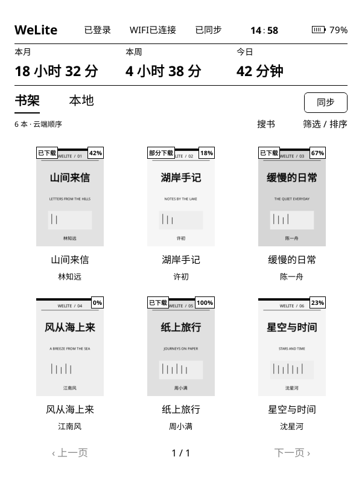
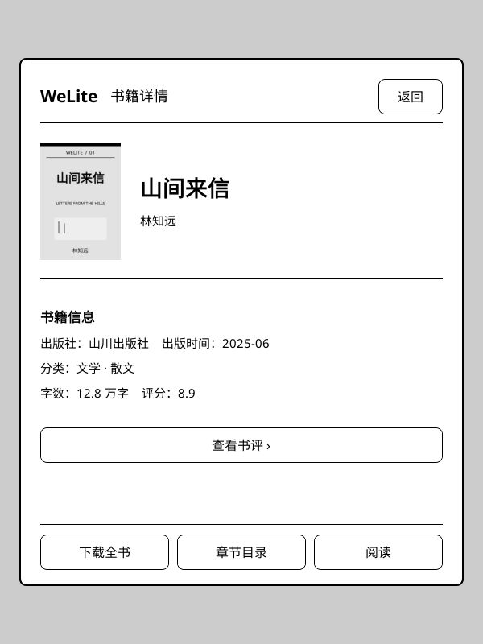
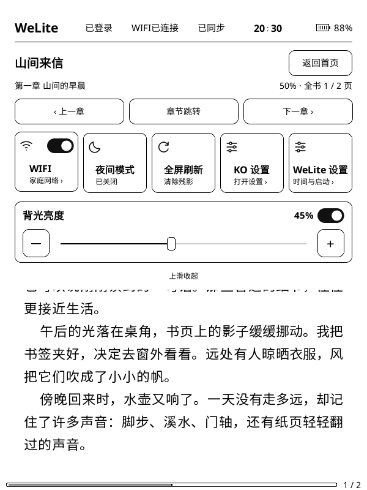
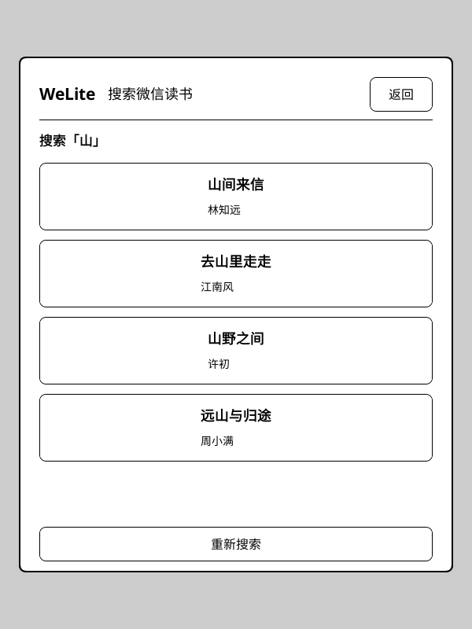
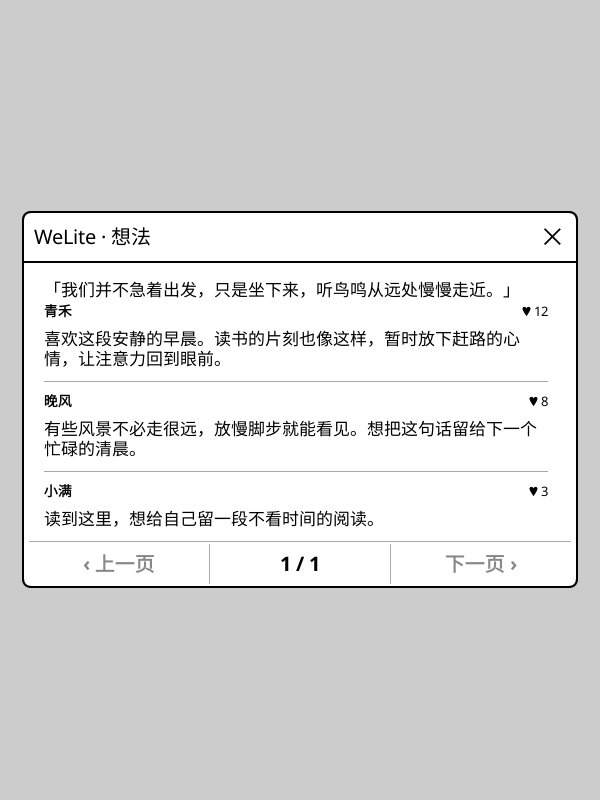
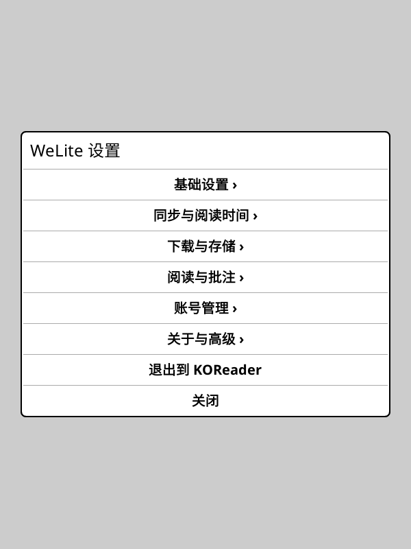

# WeLite

在 Kindle、Kobo 等墨水屏设备上，用 KOReader 阅读微信读书。保留 WeLite 简洁的黑白书架、书籍详情和下拉控制栏，接入成熟的 WeRead 登录、下载、同步、公众号与划线想法功能。

基于 **[finlater/weread.koplugin](https://github.com/finlater/weread.koplugin)** 开发，由 **Xlawy** 维护。感谢 finlater 及上游贡献者提供的功能实现。

**当前版本：v1.1.1** · [下载最新版](https://github.com/Xlawy/welite/releases/latest) · [更新日志](CHANGELOG.md) · [问题反馈](https://github.com/Xlawy/welite/issues)

> **修改版本声明 · 2026-10-22**：WeLite 是上游的独立修改版本，提供自己的 UI、阅读位置适配与交互优化，并非上游官方发行版。保留上游版权与署名，继续采用 **AGPL-3.0-only**，详见 [NOTICE](NOTICE)。

## 安装与更新

建议使用 **KOReader 2026.03 或更高版本**。

1. 前往 [Releases](https://github.com/Xlawy/welite/releases/latest)，下载 `welite.koplugin-vX.Y.Z.zip`。
2. 退出 KOReader，解压安装包，将 `welite.koplugin` 文件夹放入 `koreader/plugins/`。
3. 重启 KOReader，从 **工具 → WeLite → 书架** 进入，也可设置启动时自动打开 WeLite。

```text
koreader/plugins/welite.koplugin/
```

从旧版 WeLite 升级时，替换整个 `welite.koplugin` 目录后重启 KOReader。手动安装应先移走原 WeLite 插件目录，再解压新包，避免覆盖解压残留旧模块；设置和书籍数据目录请保留。在线更新会自动完成整个目录替换。首次启动会将原 `settings/weread.lua` 中的登录、偏好和阅读索引复制到独立的 `settings/welite-state.lua`，原文件保留；已有下载、阅读位置、批注和待同步记录不会因这次隔离而删除。WeLite 1.0.5 可与原版 `weread.koplugin` 并存，两者各有菜单、版本和更新入口。此前绑定的 `WeRead · …` 快捷动作属于原版插件，若要启动 WeLite，请重新绑定 `WeLite · …`。

默认下载目录为 KOReader 数据目录下的 **`welite/cache`**。更早版本已弃用的 `weread/cache` 下载布局仍不复用，旧文件不会自动删除。

后续可通过 **WeLite 设置 → 关于与高级 → 检查更新** 在线更新。下载包同时提供 `.sha256` 校验文件。

## 登录与认证

1. 手机打开 **微信读书 App → 我 → 设置 → 微信读书 Skill**，点击 **获取 API Key**，确认已为账号开通。
2. 点击 WeLite 顶栏的 **未登录**，或进入 **工具 → WeLite → 微信扫码登录**。
3. 使用微信扫码并在手机端确认；如出现四位验证码，在 KOReader 中输入。

请勿在截图或反馈中公开 API Key、Cookie 等账号凭证。

## 功能与截图

- **WeLite 界面**：封面书架、本地分类、搜索筛选、书籍详情与统一设置，适配黑白墨水屏。
- **书籍搜索与下载**：搜索微信读书，支持全书、多选章节下载、离线阅读与下一章预下载。
- **精准进度同步**：精确阅读位置映射，默认开书拉取、关书上传；两端发生冲突时保留选择。
- **阅读时间与统计**：在线阅读时定时上报，断网停止计时；首页展示云端本月、本周、今日时长，不补报离线阅读时间。
- **划线、想法与书评**：显示划线，查看对应想法、书评与评论；也支持公众号文章阅读。
- **下拉快捷控制**：WIFI、背光、夜间模式、全屏刷新、章节跳转，以及 KOReader / WeLite 设置。

| WeLite 书架 | 书籍详情 | 阅读控制栏 |
|:---:|:---:|:---:|
|  |  |  |

| 搜索书籍 | 划线与想法 | WeLite 设置 |
|:---:|:---:|:---:|
|  |  |  |

截图由 **v1.0.1 的真实 KOReader 模拟器界面**生成，书籍、封面、正文、账号状态和阅读数据均为演示内容；不同设备的布局与可用控制可能略有差异。[截图说明](screenshots/welite/README.md)

## 常用操作

| 操作 | 说明 |
| --- | --- |
| 点击 / 长按书籍 | 点击已下载书籍开始阅读；未下载书籍或长按书籍进入详情 |
| 书架 / 本地 | 在云端书架与已下载内容间切换 |
| 搜书 / 筛选排序 | 搜索微信读书，或筛选、排序当前书架 |
| 首页「同步」 | 刷新全部书架列表；进度仅查询本地已下载和最近阅读的书，其他书打开时再拉取 |
| 顶部下拉 / 点击顶部 | 打开快捷控制栏；阅读时增加章节导航与同步入口 |
| WeLite 设置 → 退出到 KOReader | 关闭 WeLite，回到 KOReader |

首页同步不会自动打开书籍；需要选择本地或云端进度时，等你打开对应书籍后再处理。自动拉取和关闭上传默认开启，已保存的手动关闭选择会保留。

阅读时长默认每 30 秒上报一次，也可设为 60 秒。联网且书籍进度通过核验后才发送；未知回执不会自动重报。在线期间已记录的待发送秒数保留到下次在线阅读该书时处理。旧版离线时长账本不再读取或上传，首页同步只读取云端统计。

## 设置菜单

```text
WeLite 设置
├── 基础设置             时间显示、启动行为
├── 同步与阅读时间       打开时拉取、关闭时上传、时长上报
├── 下载与存储           图片、章节预下载、缓存目录与清理
├── 阅读与批注           划线显示、边缘防误触、想法弹窗
├── 账号管理             账号状态、续期、清除账号数据
├── 关于与高级           版本、作者、开源感谢、更新与测试选项
└── 退出到 KOReader
```

原生 **工具 → WeLite** 菜单继续可用。完整同步规则、缓存说明与异常时长核对见 [使用说明](docs/usage.md)。

## SimpleUI / ZenUI 集成

支持从 [SimpleUI](https://github.com/doctorhetfield-cmd/simpleui.koplugin) 和 [ZenUI](https://github.com/AnthonyGress/zen_ui.koplugin) 的插件入口打开 WeLite 书架。

- **SimpleUI**：在「快捷操作」中新建插件操作，选择 WeLite，再加入底部栏。
- **ZenUI**：在底栏按钮或首页小组件中选择 WeLite，可自行启用和排序。

## 开发与贡献

欢迎提交 Issue 和 PR。开发前请阅读 [AGENTS.md](AGENTS.md) 与 [CONTRIBUTING.md](CONTRIBUTING.md)。

```sh
make run      # 启动已配置好的 KOReader 模拟器
make check    # 检查模块测试映射与 Lua 命名空间
make test     # 单元测试与真实 KOReader 集成测试
make package  # 生成安装包
```

模拟器配置、迁移和测试方法见 [开发文档](docs/development.md)。另见 [模块与测试映射](tests/module-map.json) 与 [发版接口检查](docs/release-api-audit.md)。

## 开源感谢与许可证

- **[finlater/weread.koplugin](https://github.com/finlater/weread.koplugin)**：登录、下载、同步、公众号、书评、划线与想法等功能底座。迁移基线为上游 [1.6.0 / ae3930f](https://github.com/finlater/weread.koplugin/tree/ae3930fa91e59ac72152fa709029e39fe6bcd1d6)。
- **[KOReader](https://github.com/koreader/koreader)**：阅读器、原生控件、排版及设备能力。
- **[Noto Emoji](https://github.com/googlefonts/noto-emoji)**：想法与书评的 Emoji 后备字体，保留 [SIL OFL 1.1](fonts/LICENSE)。

本项目整体按 **[GNU AGPL v3.0](LICENSE)**（`AGPL-3.0-only`）分发，保留上游版权、许可证和无担保声明。修改与再分发须遵守许可证，并提供对应版本的源码；详情见 [NOTICE](NOTICE) 和 [来源与许可说明](docs/licensing.md)。上游历史保留在 [上游更新日志](docs/upstream-changelog.md)。

```text
Upstream: Copyright (C) 2026 finlater and contributors
WeLite modifications: Copyright (C) 2026 Xlawy and contributors
SPDX-License-Identifier: AGPL-3.0-only
```

WeLite 是非官方项目，与微信读书、腾讯或 KOReader 不存在官方隶属关系。软件按许可证约定提供，不附带担保；软件许可证不授予书籍内容或第三方服务的使用权。
